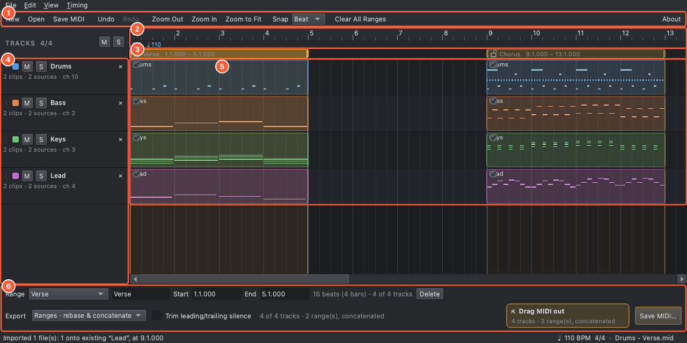
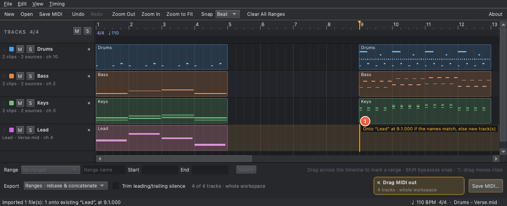
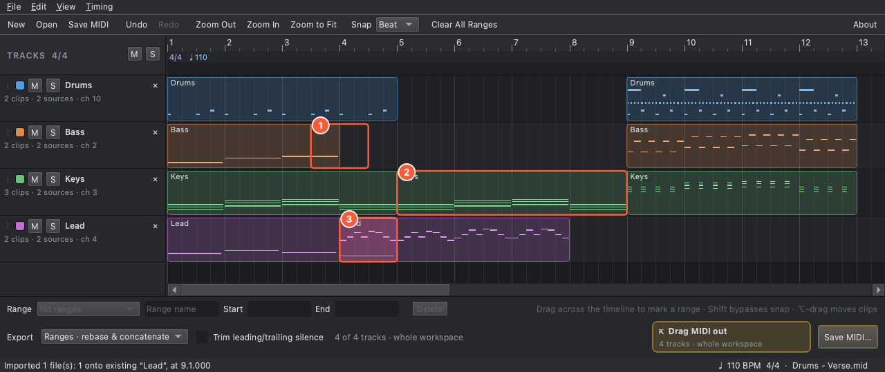
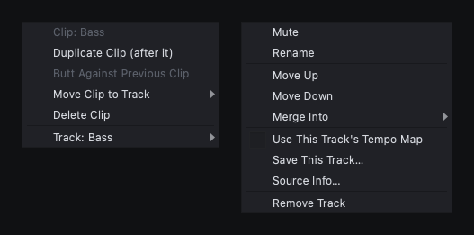
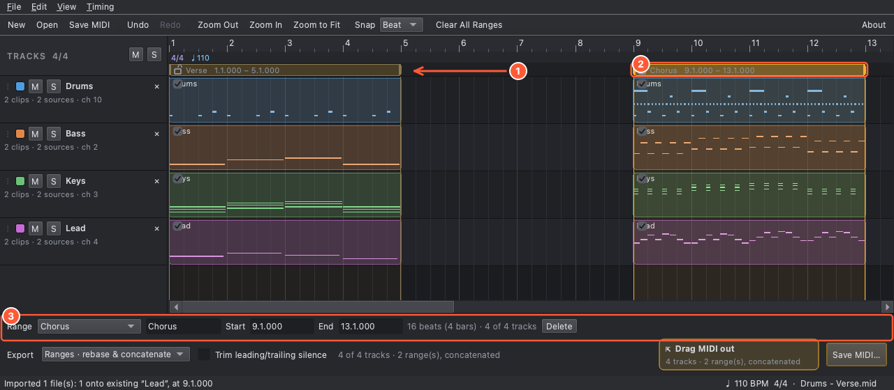
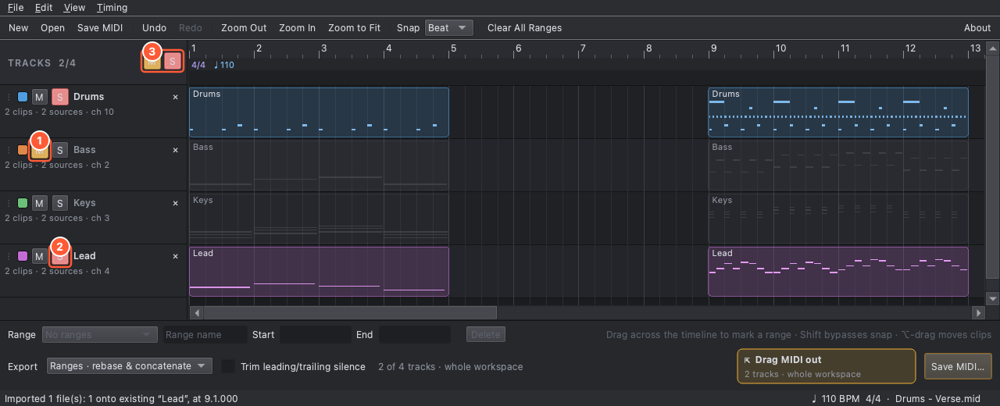
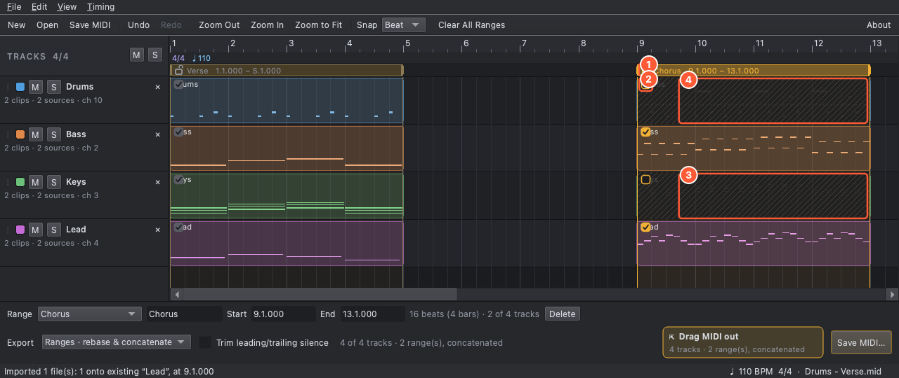
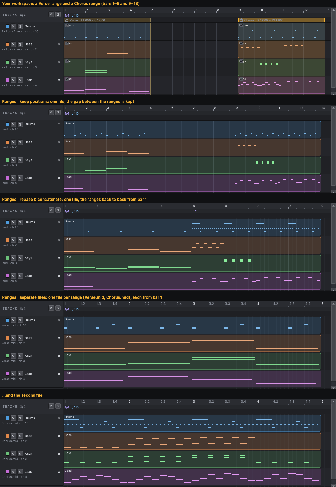

# MIDI Interchange

A palette for MIDI on its way between music apps. Drop in bits of MIDI from the apps you're working with, hold them and shape them in one place, then hand exactly what's needed to the next app.

Moving MIDI between apps is full of friction: each app drags MIDI in a different, often one-way, way. Cubase drags out one clip at a time with no position, Logic can't drag MIDI out at all, and there's no shared MIDI clipboard. MIDI Interchange sits in the middle. It takes whatever each app can give, lets you collect, trim and choose, and hands it on as plain MIDI files, the one format that works with almost every app.

It isn't a DAW or an arranger: there's no playback, no instruments and no note editing. Your source files are never changed.

## Download

The current release is **[v0.3.0-pre](https://github.com/AndyJBuchanan/MIDI-Interchange/releases/tag/v0.3.0-pre)** (2026-11-14), a pre-release. All releases are on the [Releases page](https://github.com/AndyJBuchanan/MIDI-Interchange/releases); you don't need to build anything.

| Your computer | Download |
|---|---|
| Mac with Apple silicon, macOS 15 or newer | `MIDI-Interchange-<ver>-macOS-arm64.dmg`: signed and notarised |
| Windows 10 / 11 (64-bit) | `MIDI-Interchange-<ver>-Windows-x64-Setup.exe` (installer), or the portable `.zip`. Not code-signed yet, so Windows may warn: **More info ▸ Run anyway** |

## What it's for

- **Collect from apps that give MIDI out a clip at a time.** Drag Cubase parts in one by one and drop each on its track at the bar it belongs to.
- **Round trips.** Send tracks to another app (Staccato.ai, for example), then drop what comes back on one of its tracks: every part lands back on its own track, even when the app has renamed the song.
- **Hand on exactly what the next app needs.** Mark ranges, choose which tracks each range sends, and drag the result straight into the next app, or into a folder.
- **Keep what matters intact.** Notes cut cleanly at range edges with nothing stuck, instrument and controller settings are carried into each range, and lyrics, markers and other MIDI data survive.

## How to use it

Shortcuts are shown for macOS; on Windows use Ctrl for ⌘ and Alt for ⌥ (Option). The pictures below were made from a small demo song by [tools/make_readme_screenshots.py](tools/make_readme_screenshots.py), so they show the real app.

### The idea in one minute

MIDI Interchange has one big canvas: the **timeline**. Everything you bring in shows up on it as **clips** on **tracks**, laid out in bars and beats. You work in three steps:

1. **Collect.** Drag MIDI in from your other apps (or open files) and drop it where it belongs on the timeline.
2. **Choose.** Mark **ranges** on the timeline: the bars you want to hand on. Decide which tracks each range sends.
3. **Hand on.** Drag the result into the next app, or save it as MIDI files. Your sources are never changed.

Ranges are optional, but they're what make this a palette rather than a file shuffler: you pick the verse from one app, the chorus from another, drop the drums out of one range, and export the lot as one file or as separate files.

### The window



1. **Toolbar:** New, Open, Save MIDI, Undo/Redo, zoom, the Snap list, the **Markers** button, Clear All Ranges, and About at the far right.
2. **Ruler and info rows:** bar numbers, then tempo and time signature, then markers. The **marker row** appears only when there is a marker to show: it lists the markers of the tracks an export with no ranges would include (so muting a track removes its markers), each in its track's colour. The **Markers** button (also Timing ▸ Show Markers) turns the row off; markers still show in their lanes and are still exported. The button's setting is remembered between runs.
3. **Range strip:** your ranges, as amber bars. This is where you make and move them.
4. **Track headers:** colour, **M**ute, **S**olo, name, and a ✕ to remove. Drag ⋮⋮ to reorder.
5. **Lanes:** one per track, showing its clips with their notes, lyrics and text. The timeline is this whole area.
6. **Bottom panel:** the selected range's name and exact positions, then the export controls: the mode, the **Drag MIDI out** tile and **Save MIDI…**.

Zoom with ⌘ + wheel, a trackpad pinch, ⌘= / ⌘- (or the toolbar), and ⌘0 to fit everything. The **Snap** list (off, bar, beat, 1/8, 1/16, 1/32, 1/8T, 1/16T) controls how drags line up with the grid; hold **Shift** while dragging to ignore it.

### Step 1: Bring MIDI in

Drag MIDI from another app, or `.mid` files and folders, onto the window. You can also use File ▸ Open (⌘O), open a file with the app from the Finder or Explorer, or pass paths on the command line. Each import **adds** to what you already hold, including files opened from the Finder or Explorer while the app is running: only one copy of the app runs, and it takes them into its open window.



While you drag, a line on the timeline and a label show exactly where the MIDI will land (1), and **what the label says is what happens**:

- **Over a track's lane:** it joins that track at the line's (snapped) time, but **only if the names match** (ignoring case and spacing; a renamed track still matches its original name). If nothing matches, it arrives as new track(s) at that time, and the label and status bar say why.
- **Over a track header:** the same, at bar 1.
- **Anywhere else:** new track(s), at the line's time over the timeline or at bar 1 elsewhere.

Clips dragged out of a DAW carry no position of their own, so this is how you put each one where it belongs: drop the verse at bar 1, the chorus at bar 9, onto the same track.

Dragging near either edge of the timeline scrolls it, and it grows as you drag right, so you can reach later in the song. Dropping keeps only the length needed for the content, and leaving the window mid-drag restores the previous view. (Esc doesn't cancel an incoming drag from Finder or Cubase on macOS; that depends on the other app.)

**Dropping several files at once** asks how to place them:

- **End to End:** each file starts where the previous one ends, on **one** new track named after the first file's track. Multi-track files line up by track position.
- **All at Cursor:** each file lands at the cursor, with the usual name matching.

**Round trips** work the way you'd hope. Send tracks to another app, then drop what comes back on one of its tracks: when a multi-track file matches the track you drop it on, its other tracks also join their same-named tracks, and the rest become new tracks.

- A file that repeats a track name (Staccato.ai files can) pairs its copies in order with the existing same-named tracks.
- A dropped clip with exactly the same start and end as one already on the track **replaces** it (a trimmed clip counts by its visible edges). Partial overlaps are kept and tinted.
- **Song titles:** Staccato.ai names tracks "part - song" and changes the song between generations. If no name matches exactly, names are compared again without a known song title, so "Drums - Staccato Generation" joins "Drums - Industrial EBM Anthem"; the status bar says when it did. A song title is known only from the file itself (its tempo track's name, or an ending all its tracks share), so DAW clips such as "Lead - Verse" and "Lead - Chorus" never match.

The first file with a tempo map sets the workspace tempo. To adopt another file's map, right-click the ruler, the tempo row or the marker row and choose Tempo Map (also in Timing ▸ Tempo Map; the current file is ticked), or right-click one of that file's tracks and choose Use This Track's Tempo Map (shown only for a track whose file has a tempo map). Undo reverses it.

### Step 2: Tidy what you hold

Once things are on the timeline you can shuffle them. None of this changes your source files.

Click a track's colour box to choose a palette colour or **More colours…**, and to set its **Export MIDI channel**. **Original channels** (the default for every track) keeps each clip's own MIDI channels. Choosing **1–16** sends every clip on that track to that channel: all channel messages (notes, controllers, program changes, pitch bend, pressure) in every export, whether by **Save MIDI…**, **Save This Track…** or drag-out. The number appears in the colour box. Choosing Original channels again restores the originals, and each change is one undo step. Moving a clip to another track uses that destination's setting; your source MIDI is never changed.



1. **Trim** a clip: ⌥-drag its left or right edge (the cursor turns to ↔). Here the Bass verse has lost its last bar. Notes outside a trim are left out of exports, and right-click ▸ **Restore Full Clip** puts both edges back.
2. **Duplicate** a clip: right-click ▸ Duplicate Clip, or ⌥⌘-drag it. The copy goes straight after the original; here the Keys verse was copied into bars 5–9.
3. **Move** a clip: ⌥-drag it in time and onto another track. Here the Lead chorus slid back over the end of its verse. **Overlaps** are allowed and tinted red; both clips' notes are exported, merged.

4. **Split** a clip: hold **⌘ on Mac or Ctrl on Windows** over it. The cursor becomes scissors, and a vertical line previews the snapped cut position. **Click** to split into two adjacent pieces on the same track. Hold **Shift** as well to cut off-grid. One Undo rejoins the pieces.

The rest of the rules, in one place:

- **Moving:** drag below the last track to make a new track. With Shift held, moving or copying on the source track bypasses snap; targeting another track (or a new one below the lanes) keeps the clip's original time. Returning to the source track resumes unsnapped movement. A track left empty is removed (Undo restores it). A plain move snaps the clip's visible start to the grid.
- **Trimming:** the edge snaps like a move (Shift bypasses it) and can't go past where the clip's MIDI originally started or ended. An edge placed off the grid with Shift stays there until the clip is moved. A clip too narrow to hold both edges can only be moved: zoom in to trim it. A plain drag on a clip edge still makes or resizes a range.
- **Splitting:** each half must retain at least one snap step (one source tick with snap off or bypassed); a cut at an edge or too close to it does nothing. Already trimmed clips can be split too. Both halves keep their name and can be moved, copied or trimmed independently. Either half can be extended back into the original MIDI; right-click ▸ **Restore Full Clip** restores its full original extent, which may overlap the other half. Notes crossing the split are released and restarted there on export.
- **Cursors:** ⌥/Alt shows a move arrow (resize at a trimmable edge); ⌥⌘/Alt+Ctrl shows a move arrow with a plus and copies, including at edges.
- **Butt Against Previous Clip** (right-click) closes the gap before a clip, using its trimmed start.



The **clip menu** (left) has Duplicate, Butt Against Previous Clip, Restore Full Clip (on a trimmed clip), Move Clip to Track (or New Track) and Delete Clip. Its **Track:** submenu, and a right-click on a track header, give the **track menu** (right): Mute/Unmute, Rename, Move Up/Down, **Merge Into** another track, **Save This Track…** (exports just that track, even if it's muted), Source Info… and Remove Track.

Tracks: click a name to rename it, drag ⋮⋮ to reorder, ✕ to remove. File ▸ New (⌘N, also on the toolbar) clears the workspace, and Undo brings it back (see [Returning to your workspace](#returning-to-your-workspace) for what happens if you then quit). **Undo / redo** (⌘Z / ⇧⌘Z) cover everything.

### Step 3: Mark ranges

A **range** is a stretch of the timeline you want to hand on. Ranges are the heart of the app.

**No ranges? You get everything.** Until you mark a range, an export is the whole timeline, with each track's mute and solo settings deciding which tracks are included. Ranges only come into play once you've made at least one.



- **Make one** by dragging across empty timeline space, in the ruler or in the lanes. It snaps to the grid (Shift bypasses). Here "Verse" covers bars 1–5 and "Chorus" bars 9–13.
- **Resize or move** a range (1): drag an edge (in any row), or drag its body in the range strip.
- **Select** a range (2) by clicking it. It turns brighter and its details appear in the bottom panel (3).
- **Name it and set exact positions** in the panel: type a name, and `bar.beat.tick` (480 ticks per quarter) into Start and End. You can also pick it in the Range list, double-click it, or right-click ▸ Edit Range…. Unnamed ranges are called "Range 1", "Range 2" and so on, in order.
- **Delete** with Backspace or Delete, the panel's Delete button, or Edit ▸ Delete Range. **Tab** cycles through the ranges, **Escape** deselects, and **Clear All Ranges** (toolbar and Edit menu) removes them all.

Notes that straddle a range's edge are cut cleanly, with nothing left hanging, and the instrument and controller settings in force are carried into the start of each range.

### Step 4: Say who plays in each range

**For the whole song: Mute and Solo.** Each track has **M** (mute) and **S** (solo). Several tracks can be soloed at once; ⌥-click **S** for an exclusive solo, and ⌥-click **M** to set every mute at once. The boxed **M** and **S** buttons above the track headers clear all mutes or all solos.



Here Bass is muted (1), Lead and Drums are soloed (2), so only those two play: the others are dimmed. The boxed buttons (3) light up while any mute or solo is active, and click to clear them.

**For one range: include and exclude.** A new range simply follows the global mute and solo, shown by greyed checkboxes. To make a range different, **lock** it:



- Click the **padlock** in the range's header (1) to lock its track selection. Its checkboxes (2) become live: untick one to leave that track out of this range only. The left-out section is hatched (3, 4): the range still takes its time there, but that track is silent.
- A locked range **ignores later global mute/solo changes**. Unlock it and it immediately follows the global result again.
- Right-click a range for **Include All Tracks**, **Exclude All Tracks** (both lock the range first) and **Unlock**.
- Colours inside a range show what it will export, so you can read the result straight off the timeline. The panel's length line says how many tracks it sends ("2 of 4 tracks").

A track that no exported range includes is left out of the file altogether.

### Step 5: Hand it on

Pick a mode in the **Export** list at the bottom. With **no ranges defined, the whole timeline is exported**, with the tracks' mute and solo settings deciding which tracks go. Once you have ranges, you choose how to combine them:



- **Whole workspace:** the whole timeline, as it sits. The tracks' mutes and solos decide which tracks are included.
- **Ranges · keep positions:** one file; the ranges keep their places on the timeline, and any gaps stay empty. Overlapping or touching ranges merge.
- **Ranges · rebase & concatenate** (the default once you have ranges): one file, with the ranges **joined back to back** from bar 1, in the order they're listed. Verse, then Chorus, with no gap.
- **Ranges · separate files:** **one file per range**, each starting at bar 1.

Each track's **Export MIDI channel** (Step 2) is applied to the output in every mode.

Tick **Trim leading/trailing silence** to cut the output down to its first and last note (or lyric); every track moves by the same amount, so they stay aligned.

Then either:

- **Save MIDI…** (⌘S) to write files. For separate files, the name you choose gets each range's name added.
- Drag the **Drag MIDI out** tile straight into another app or a folder. The tile and the line beside the Trim box say how many tracks and files will go.

**File names:** a named range uses its name and an unnamed one uses "Range 1", "Range 2"… A one-range export is named after it (`Verse.mid`); a combined export joins the labels (`Verse + Chorus.mid`); and separate files dragged out are named by their range alone (`Verse.mid`; a repeat gets " (2)"). Separate files from **Save MIDI…** suggest `Export.mid`, giving `Export - Verse.mid` and `Export - Chorus.mid`. Whole exports are named after the track when there is one track, otherwise "MIDI Interchange Export".

An export whose clips all come from one song keeps the song's title in its tempo track, so it can be matched again when it comes back.

### Everything you can do (quick reference)

| To… | Do this |
|---|---|
| Bring MIDI in | Drag MIDI or `.mid` files/folders onto the window; File ▸ Open (⌘O); Open with… from the Finder/Explorer; command-line paths |
| Place a drop | Drop over a lane (joins a same-named track at that time), a header (bar 1), or empty space (new tracks) |
| Place several files | Choose End to End or All at Cursor when asked |
| Move a clip | ⌥-drag it. Shift bypasses snap on the source track and keeps its original time on another track; drag below the last track for a new track |
| Trim a clip | ⌥-drag its left or right edge. Right-click ▸ Restore Full Clip to undo the trim |
| Copy a clip | ⌥⌘-drag it, or right-click ▸ Duplicate Clip (placed straight after it) |
| Butt a clip against the previous one | Right-click ▸ Butt Against Previous Clip |
| Move a clip to another track | Right-click ▸ Move Clip to Track (or New Track) |
| Delete a clip | Right-click ▸ Delete Clip |
| Set a track's colour or export channel | Click its colour box ▸ a colour, **More colours…**, or **Export MIDI channel** ▸ Original channels or 1–16 |
| Rename a track | Click its name |
| Reorder tracks | Drag ⋮⋮, or right-click ▸ Move Up / Move Down |
| Combine tracks | Right-click ▸ Merge Into (another track) |
| Remove a track | ✕, or right-click ▸ Remove Track |
| Save just one track | Right-click ▸ Save This Track… |
| See where a track came from | Right-click ▸ Source Info… |
| Mute / solo | **M** / **S** on a track. ⌥-click S for exclusive solo, ⌥-click M for all mutes. Boxed M / S above the tracks clear them |
| Make a range | Drag across empty timeline space (ruler or lanes) |
| Resize / move a range | Drag an edge (in any row) / drag the body in the range strip |
| Name a range, exact positions | Range list or double-click ▸ type a name and `bar.beat.tick` Start/End in the bottom panel; or right-click ▸ Edit Range… |
| Delete / cycle / deselect ranges | Backspace or Delete (or the panel's Delete, Edit ▸ Delete Range) / Tab / Escape. Clear All Ranges is on the toolbar and the Edit menu |
| Choose tracks per range | Padlock in the range header, then tick or untick its checkboxes; right-click ▸ Include All / Exclude All / Unlock |
| Snap | Snap list on the toolbar, or Timing ▸ Snap. Hold Shift while dragging to bypass it |
| Zoom | ⌘ + wheel, trackpad pinch, ⌘= / ⌘- / ⌘0 (fit), or the toolbar |
| Lane height | ⌥ + wheel, or ⌘⇧= / ⌘⇧- (View ▸ Taller / Shorter Lanes) |
| Choose an export mode | The Export list: whole workspace, keep positions, rebase & concatenate, separate files |
| Trim silence | Tick Trim leading/trailing silence |
| Export | **Save MIDI…** (⌘S), or drag the **Drag MIDI out** tile into another app or a folder |
| Start again | File ▸ New (⌘N, also on the toolbar). Export settings are kept; Undo brings your work back until you quit |
| Return to your work | Just reopen the app: the workspace is restored. Opening files while it runs adds them to the open window. See [Returning to your workspace](#returning-to-your-workspace) |
| Undo / redo | ⌘Z / ⇧⌘Z cover everything |
| Tempo | The first file with a tempo map sets it. Right-click the ruler, tempo row or marker row ▸ Tempo Map (or Timing ▸ Tempo Map) adopts another file's; so does a track's right-click ▸ Use This Track's Tempo Map |
| Show / hide the marker row | **Markers** on the toolbar, or Timing ▸ Show Markers. Remembered between runs; markers still export |
| About | The About button at the right end of the toolbar shows the version and the project link |

Each lane shows its clips' notes, lyrics and text; the rows above show tempo, time signature, markers (see the window list above) and the ranges. The status bar shows the position under the pointer.

### Returning to your workspace

The current workspace is restored when you reopen the app, including its MIDI data, trims, ranges, mute/solo settings, channel overrides, export settings and timeline view. Undo history starts fresh. Original files and DAW drag temp files are not needed for restoration.

The app saves on exit and checkpoints pending changes every two minutes once you have been inactive for at least 15 seconds. Active work can delay a checkpoint. After a crash, changes since the last checkpoint may be lost. If the saved session is incompatible or damaged, the app warns you and starts empty; the rejected file is kept only until you quit. After an unclean exit the app says so when it restores the last checkpoint.

Only one instance runs at a time. Opening MIDI files from Finder/Explorer or another launch adds them to the existing window (they import as in Step 1); launching again with no files just brings that window forward. **New** clears the workspace and Undo can bring it back, but undo history isn't kept: a normal quit saves the empty state, so quitting after New starts empty next time. The Markers button is remembered separately from the session.

## Works with

Tested by hand on macOS (2026-11-09 and 2026-11-10). Drag and drop works as far as each app allows. On Windows the app builds and its tests pass, but drag and drop with DAWs hasn't been tried yet. Details, the clipboard investigation and open issues are in [docs/INTEROP_FINDINGS.md](docs/INTEROP_FINDINGS.md).

Key: ✓ works · ◐ works within limits (see notes) · — the app doesn't support it · ☐ not tested or not yet confirmed

"Drag-in" means dragging from the app into MIDI Interchange; "drag-out" means dragging from MIDI Interchange into the app.

| App | macOS drag-in | macOS drag-out | Windows drag-in | Windows drag-out | Notes |
|---|---|---|---|---|---|
| Cubase 16 | ◐ | ✓ | ☐ | ☐ | Cubase drags out one clip at a time (a Cubase limitation; also true when dragging to the Finder). A drag into Cubase doesn't set its tempo (possibly normal for a drag into an open project); opening the saved file does |
| Reason 14 | ✓ | ◐ | ☐ | ☐ | Drag-out works, whole and by range, but Reason splits a track that mixes MIDI channels into one track per channel, and a drag doesn't set its tempo |
| RapidComposer 6 | ◐ | ☐ | ☐ | ☐ | Single clip/track only |
| Scaler 3 | ◐ | ◐ | ☐ | ☐ | Where it applies, e.g. the main page |
| Staccato.ai | ✓ | ✓ | ☐ | ☐ | Round trips match tracks even when Staccato renames the song |
| Logic Pro | — | ✓ | ☐ | ☐ | Logic doesn't drag MIDI out. A dragged file imports cleanly, but Logic doesn't take its tempo; a new project made from the file does |
| Synthesizer V Studio 2 | ☐ | ☐ | ☐ | ☐ | |
| Finder / Explorer | ✓ | ✓ | ☐ | ☐ | Files and folders in; files out (used throughout testing) |

Yamaha Omnivocal isn't listed: no MIDI is dragged to or from it. It takes its MIDI from Cubase.

**Clipboard:** Cubase, Reason and Logic Pro don't put usable MIDI on the system clipboard, so copy and paste between them and MIDI Interchange isn't possible. Pro Tools and Sibelius use `public.midi-audio`, a possible future route; see the findings page.

For each app check: does the drop import at all (if not, note the formats listed in the error); are track names, channels, lyrics and tempo intact; does a rebased range land at the drop position with the correct length; and are there no stuck notes at range edges.

## Known limitations

- **Reason automation lane:** importing a channel-overridden range can create an unwanted **Controller #254** automation lane, although the channel override works. Delete the unwanted lane in Reason. Its cause is unresolved; see [the findings](docs/INTEROP_FINDINGS.md#reason-unexpected-automation-lane-after-channel-override-2026-11-13).

- **Drag and drop depends on the other app.** File URLs and any data starting with `MThd` are handled. Qt can't receive **macOS file promises** or **Windows virtual files**; no app tested so far needed them. If a drop carries no usable MIDI, the app lists the formats it was offered, which helps a lot in a bug report. Drag-out offers temp files (in `$TMPDIR/MIDI Interchange Drag`, pruned after 24 h).
- **Mixed channels:** a clip moved onto another track keeps its own MIDI channel(s), so a track can end up mixing channels (its header lists them all). MIDI Interchange exports it as one track, but some importers split it: **Reason 14** turns it into one track per channel. To get one track there, use the track colour box’s export-channel override, or assemble clips that share a channel.
- **Marker row and locked ranges:** the marker row follows the global mute and solo, not a locked range's own track choices. A locked range's export can include markers of a globally muted track that the row doesn't show.
- SMPTE-division files are rejected with a clear message.

Everything still to do, agreed or not, is listed in [docs/ROADMAP.md](docs/ROADMAP.md).

## Run from source (macOS / Windows)

Source: https://github.com/AndyJBuchanan/MIDI-Interchange

```bash
git clone https://github.com/AndyJBuchanan/MIDI-Interchange.git && cd MIDI-Interchange
python3.12 -m venv .venv
.venv/bin/pip install -r requirements.txt -r requirements-dev.txt   # Windows: .venv\Scripts\pip
.venv/bin/python tools/make_demo_midi.py          # optional: writes demo files to samples/
.venv/bin/python main.py                          # or: main.py samples/*.mid
```

Run the tests with `.venv/bin/python -m pytest -q`. The GUI tests use Qt's offscreen platform.
For Windows commands, a new machine, VS Code setup or troubleshooting, see [docs/DEVELOPMENT.md](docs/DEVELOPMENT.md).

## Documentation

- [docs/DESIGN_BRIEF.md](docs/DESIGN_BRIEF.md) is the original project spec, kept verbatim.
- [docs/DESIGN_NOTES.md](docs/DESIGN_NOTES.md) covers how the spec was interpreted: status, decisions, risks, known gaps and the to-do list.
- [docs/DEVELOPMENT.md](docs/DEVELOPMENT.md) explains how to set up on a new machine (macOS or Windows), run, test, debug and build, including in VS Code. **Before committing from a new clone**, read its section on setting each clone's commit identity and GitHub login.
- [docs/INTEROP_FINDINGS.md](docs/INTEROP_FINDINGS.md) has the app-by-app drag test results, the clipboard investigation and open interop issues.
- [docs/TEST_CHECKLIST.md](docs/TEST_CHECKLIST.md) is the manual test checklist, one section per feature plus a regression pass.
- [docs/RELEASING.md](docs/RELEASING.md) explains the version number, tag naming, and building and publishing a release. Release notes are in [docs/releases/](docs/releases/).

## Architecture

```
main.py                         entry point (also handles macOS FileOpen events)
midi_interchange/core/          pure Python, no Qt dependency
  timing.py     Fraction-of-quarter canonical time, TempoMap, BBT, snapping
  events.py     Event(time, mido msg, seq), FIFO note pairing
  document.py   Workspace → Source → Track → Clip → Event, undo snapshots
  ranges.py     half-open [start, end) ranges, merging
  import_smf.py SMF → canonical model
  placement.py  where a drop lands: plan_drop() decides, place_imports() carries it out
  names.py      every naming rule: name matching, song titles, range labels, file names
  export_smf.py canonical model → SMF (whole / preserve / rebase / separate, trim)
midi_interchange/interchange/   transport boundary (drop payload extraction, temp files for drag-out)
midi_interchange/ui/            PySide6: controller (undo + signals), timeline, track panel, export panel
```

The main design decisions:

- **Time** is an exact `Fraction` of quarter notes, so mixing 96/480/960/1000 PPQ sources loses nothing. On export the PPQ is the LCM of the source PPQs and every output time's denominator. If that would exceed the 15-bit SMF limit, it falls back to the largest source PPQ (minimum 480) and rounds.
- **Events** keep the original mido message object. SysEx, unknown metas, sequencer-specific data and text bytes (decoded as latin-1, so the round trip is byte-exact) survive untouched. Text is re-decoded as UTF-8 for display only.
- **Import policy**: tempo and time-signature events move into the source's `TempoMap`. The first `track_name` at tick 0 becomes the editable track name; a pure conductor track's name is kept as the source's song title when the track names end in it. `end_of_track` sets the clip length. Format 0 files are split per channel, plus a `· Meta` track for non-channel events. A pure conductor track is dropped, and a track with only meta events becomes an *auxiliary* track.
- **Tempo policy**: the first source that has a tempo map becomes authoritative. Later conflicting maps stay on their source, are reported, and can be adopted from the menu. They are never merged.
- **Track names**: an unchanged name is written back with its original bytes; an edited name is written as UTF-8. The conductor track is named after the song when every exported clip comes from one song, otherwise it's unnamed.

### Export boundary policy (`core/export_smf.py`)

- Notes are paired FIFO per (channel, pitch). A note that sounds inside `[s, e)` is exported. If it started before `s` it is clipped to start at `s` (or omitted when `partial_notes=False`). If it runs past `e` it gets a note-off synthesized at `e`. **Every note-on gets a note-off.**
- At `s`, the exporter re-emits the last program change, CCs (except 120–127), pitch bend, channel pressure and key signature that came before `s`, **in their original order**. That keeps bank-select→program and RPN/NRPN sequences valid. SysEx and poly aftertouch are not carried.
- The tempo and time signature in effect at `s` are written at the start of each segment.
- Lyrics, text, markers and SysEx are included when their time falls in `[s, e)`.
- **Preserve** mode merges overlapping or adjacent ranges and keeps positions. **Rebase** concatenates ranges in list order; it's the default. With no ranges, the whole workspace is exported. **Separate** writes one rebased file per range. End-of-track is placed at the range end so loop lengths survive.
- **Tracks per range:** range exports use each range's own track checkboxes, not the track toggles. A track excluded from a range is silent there (the range still takes its time); a track no exported range includes is left out of the file. Whole export uses the track toggles.
- **File names:** a one-track export is named after the track; otherwise after the range names ("Verse + Chorus"). Separate files dragged out are named by their range alone ("Verse.mid", a repeat gets " (2)"); Save MIDI… adds the range name to the name you choose.
- **Clip trims** use the same edge rules as ranges: a note that started before a trimmed start sounds from the edge, a note running past a trimmed end is released at it, and the program, controllers and pitch bend in force are written at the start. A whole export writes untrimmed clips exactly as imported.
- **Trim** applies to the whole output only. It cuts to the first and last note or lyric and moves every track by the same amount, so alignment is never broken.

## Packaging

```bash
scripts/build_macos.sh            # → dist/MIDI Interchange.app + dist/MIDI-Interchange-<ver>-macOS-<arch>.dmg
```
```bash
powershell -ExecutionPolicy Bypass -File scripts\build_windows.ps1   # → dist\MIDI-Interchange-<ver>-Windows-x64-Setup.exe (installer) + portable .zip
```

Both scripts use PyInstaller with `midi_interchange.spec`. The app icon files in `assets/icon/` are made from the master artwork `assets/icon/icon.png` (1024 px, transparent corners) by `tools/make_icons.py`; rerun it after changing the master.

- **macOS:** when the git-ignored `scripts/signing.local.env` is set up, the app and DMG are signed with Developer ID and the hardened runtime, notarised by Apple and stapled. Verified for v0.2.0-pre (2026-11-10): Gatekeeper reports "Notarized Developer ID". Without that file the build falls back to ad-hoc signing. Setup is in [docs/DEVELOPMENT.md](docs/DEVELOPMENT.md#macos-signing-and-notarisation).
- **Windows:** builds a one-folder app, a portable zip and an installer (Inno Setup: per-user install with no admin prompt, Start-menu shortcut, uninstaller, *Open with* for `.mid`). Verified on 2026-11-09 (Windows 11 x64, Python 3.12.10): the app runs from the zip and after a silent install, which also uninstalls cleanly. For v0.2.0-pre (2026-11-10) the full test suite passes on Windows too. It is **not code-signed** yet, so SmartScreen warns on download. See [docs/DEVELOPMENT.md](docs/DEVELOPMENT.md#windows-build).
